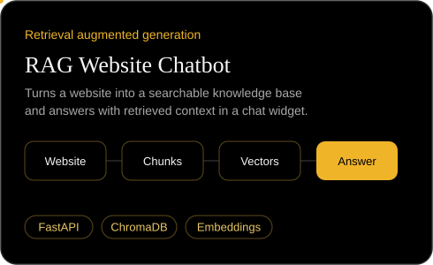
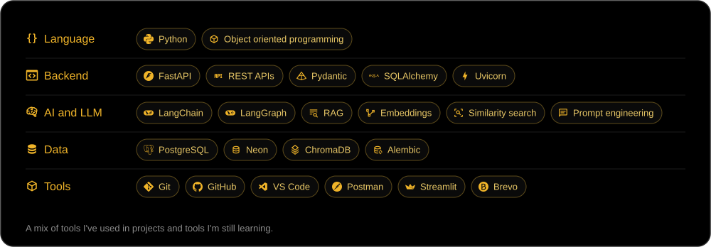
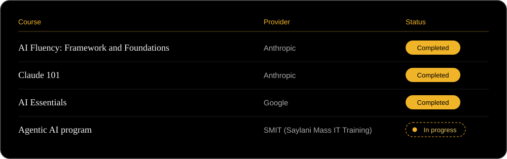

<a href="https://github.com/muhammadsohaib796">
  
</a>
<p align="center">
  
</p>
<p align="center">
  <a href="https://www.linkedin.com/in/sohaib-shakeel-b0a7b4222/"></a>
  <a href="mailto:sohaibshakeel796@gmail.com"></a>
  <a href="https://github.com/muhammadsohaib796?tab=repositories"></a>
</p>
About me
I'm a BS Artificial Intelligence student at Benazir Bhutto Shaheed University Lyari, and I'm currently in the Agentic AI program at SMIT (Saylani Mass IT Training). I work mostly in Python, building backend services and LLM applications.
I learn by building, and I care about understanding how a system works underneath rather than copying a pattern that happens to run. My recent work includes an order agent that pauses mid-workflow until a customer replies to an email, and a pipeline of four agents that research, write and review their own reports.
I'm looking for an internship or junior role in AI or backend engineering, in Karachi or remote, and I'm happy to collaborate on meaningful technical projects.
Current focus
```python
current_focus = {
    "building": ["backend services with FastAPI", "agent workflows with LangGraph"],
    "learning": ["advanced Python and OOP", "RAG and vector databases", "system design"],
    "program":  "SMIT Agentic AI",
    "open_to":  ["AI / backend internships", "junior roles", "collaboration"],
}
```
Featured projects
<a href="https://github.com/muhammadsohaib796/OrderOps-AI">
  
</a>
<p>
  <a href="https://order-ops-ai.vercel.app/"></a>
  <a href="https://github.com/muhammadsohaib796/OrderOps-AI"></a>
</p>
<!-- Replace the first link below with your RAG Website Chatbot repository URL once it is public. -->
<a href="https://github.com/muhammadsohaib796?tab=repositories"></a>
<a href="https://github.com/muhammadsohaib796/Multi-Agent-Research-System"></a>
Skills and tools


Certifications and learning

GitHub statistics
<p align="center">
  
  
</p>

Connect with me
I'm open to internships, junior roles and collaboration. The quickest way to reach me is by email or LinkedIn.
<p>
  <a href="https://www.linkedin.com/in/sohaib-shakeel-b0a7b4222/"></a>
  <a href="mailto:sohaibshakeel796@gmail.com"></a>
</p>
